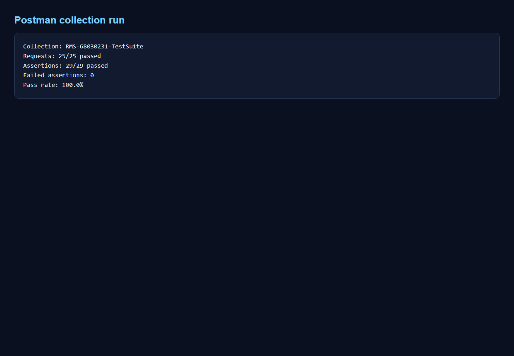
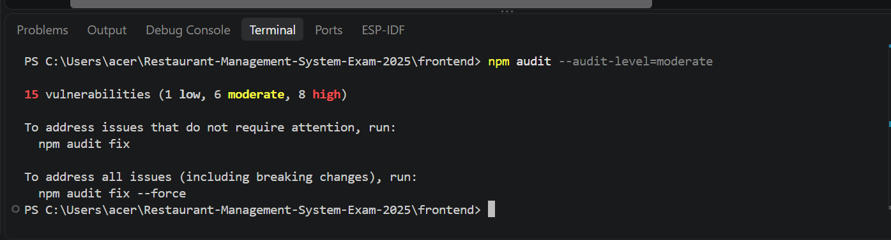
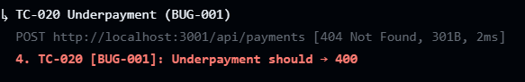
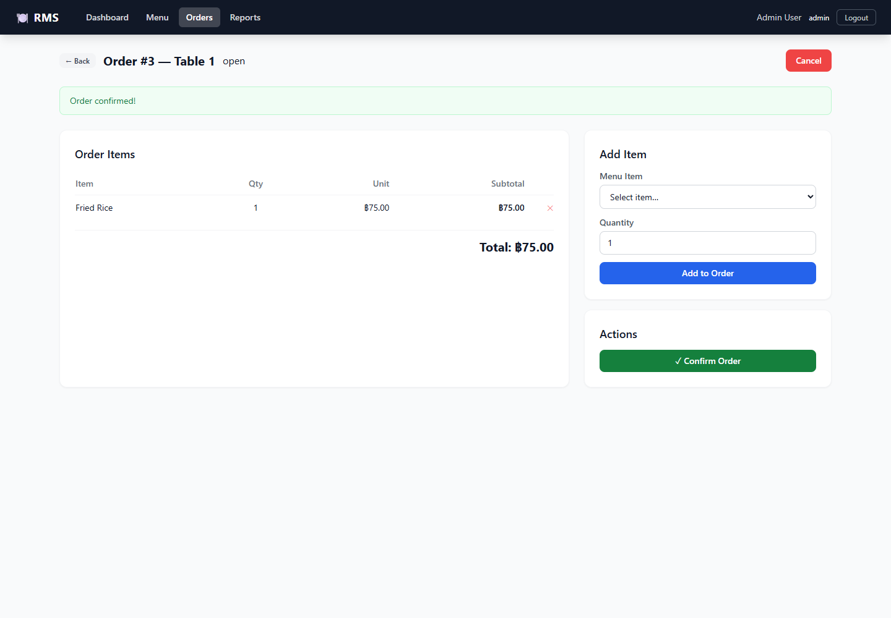

# Restaurant Management System (RMS) — Exam Result

| รายการ | ข้อมูล |
|---|---|
| ชื่อ-นามสกุล | ภูธนพัตน์ ตากิ่มนอก |
| รหัสนักศึกษา | 68030231 |
| วันที่สอบ | 17 พฤศจิกายน 2569 (2026) |

## Project Overview

ระบบจัดการร้านอาหารสำหรับการยืนยันตัวตนตามบทบาท จัดการเมนู เปิดและยืนยันออเดอร์ รับชำระเงิน และดูรายงานยอดขาย ใช้ API ที่มี JWT และ PostgreSQL ผ่าน Prisma

- Source Repository: `https://github.com/surachai-p/Restaurant-Management-System-Exam-2025.git`
- Student Repository: `https://github.com/Pootanapat/Restaurant-Management-System-Exam-2025.git`

## Tech Stack

| Layer | Technology |
|---|---|
| Frontend | React 18, Vite 8, TypeScript, Tailwind CSS |
| Backend | Node.js 22, Express, TypeScript |
| Database | PostgreSQL 16 |
| ORM | Prisma 5 |
| Testing | Vitest, Supertest, Postman/Newman |
| Container | Docker, Docker Compose |
| CI/CD | GitHub Actions, Render, Vercel |

## Production URLs

| Service | URL | สถานะ |
|---|---|---|
| Frontend (Vercel) | https://pootanapat-rms-68030231.vercel.app | ✅ Live |
| Backend (Render) | https://pootanapat-rms-api.onrender.com | ✅ Live |
| API Health Check | https://pootanapat-rms-api.onrender.com/api/health | ✅ HTTP 200 |
| Database | Neon PostgreSQL 16 — connection string เก็บเป็น Render secret | ✅ Connected |

## Test Plan

### 1.1 Test Scope

| Feature | เหตุผลที่ทดสอบ |
|---|---|
| Auth | ป้องกันผู้ไม่มีสิทธิ์และตรวจการออก JWT |
| Menu | ตรวจ CRUD, search และ role-based access |
| Order | ป้องกันการเปิดออเดอร์ซ้ำโต๊ะเดียวและตรวจ state transition |
| Payment | ป้องกัน underpayment และตรวจเงินทอน |
| Report | ตรวจยอดขายและขอบเขตวันที่ |
| Security | ตรวจ JWT, role, SQL injection และ dependencies |

Out of Scope:

| ขอบเขต | เหตุผล |
|---|---|
| Payment gateway จริง | ระบบข้อสอบใช้ข้อมูลจำลอง ไม่มีบัญชีผู้ให้บริการชำระเงินจริง |
| Load/Stress test ระดับ production | เวลาสอบจำกัดและไม่มี workload target จากโจทย์ |

### 1.2 Test Approach

| ประเภท | เครื่องมือ | รายละเอียด |
|---|---|---|
| Unit | Vitest | กฎคำนวณเงินทอนและ validation |
| API/Integration | Supertest | Health, input validation, JWT และ regression ของบั๊ก 5 จุด |
| E2E API | Newman | รัน collection 24 requests กับ Docker staging และ Production จริง |
| Security | npm audit + Newman | Dependency scan, no-token, role check, injection input |
| Smoke | Playwright Core + Edge | Login → Order → Payment และเก็บภาพหลักฐาน |
| Staging | Docker Compose | PostgreSQL 16 + Backend + Frontend multi-container |

### 1.3 Test Environment

| รายการ | เวอร์ชัน / ค่า |
|---|---|
| OS | Windows NT 10.0.26200.0 |
| Host Node.js | 24.13.0 |
| CI/Docker Node.js | 22 |
| npm | 11.6.2 (host) |
| Docker Engine | 29.6.1 |
| Docker Compose | 5.3.0 |
| PostgreSQL | 16-alpine ใน staging; Neon PostgreSQL 16 สำหรับ production |
| Browser | Microsoft Edge (headless evidence run) |
| Newman | 6.2.3 |

### 1.4 Entry / Exit Criteria

Entry criteria:

- [x] Fork ถูก clone และ Backend/Frontend build ผ่าน
- [x] Docker PostgreSQL 16 เชื่อมต่อและ seed สำเร็จ
- [x] `/api/health` ตอบ HTTP 200 และ `status=ok`
- [x] Postman Collection พร้อมและรันด้วย Newman ได้
- [x] Neon PostgreSQL 16 เชื่อมกับ Render Production และ seed สำเร็จ

Exit criteria:

| เงื่อนไข | เกณฑ์ | ผลปัจจุบัน |
|---|---:|---:|
| Newman Pass Rate | ≥ 80% | 100% |
| Critical Bug ที่ยังเปิด | 0 | 0 |
| Unit/API tests | ผ่านทั้งหมด | 25/25 |
| Production smoke test | 4/4 | 4/4 ผ่าน |

### 1.5 Business Risk

| # | Feature | ผลกระทบ | ระดับ |
|---|---|---|---|
| 1 | Payment | รับเงินไม่ครบแต่ปิดออเดอร์ ทำให้รายได้และบัญชีคลาดเคลื่อน | Critical |
| 2 | Order | เปิดหลายออเดอร์บนโต๊ะเดียว ทำให้เสิร์ฟผิดโต๊ะและคิดเงินซ้ำ | High |
| 3 | Menu authorization | พนักงานไม่มีสิทธิ์แก้ราคา ทำให้สูญเสียรายได้ | High |

## Test Cases & Results

ผลด้านล่างมาจาก Newman และ regression tests ที่รันจริงกับทั้ง Docker staging และ Production API

| TC-ID | Type | Feature | Scenario / Input | Expected | Actual | Result |
|---|---|---|---|---|---|---|
| TC-001 | Positive | Health | `GET /api/health` | 200, status ok | 200, status ok | PASS |
| TC-002 | Positive | Auth | Admin credential ถูกต้อง | 200 + JWT | 200 + JWT | PASS |
| TC-005 | Negative | Auth | Password ผิด | 401 | 401 | PASS |
| TC-006 | Negative | Auth | Body ว่าง | 400 | 400 | PASS |
| TC-007 | Security | Auth | เรียกเมนูโดยไม่มี JWT | 401 | 401 | PASS |
| TC-009 | Positive | Menu | ค้นหา `Pad Thai` | 200 + result | 200 + result | PASS |
| TC-010 | Security | Menu | SQL injection text | ไม่คืนทุกรายการ | 200 + empty array | PASS |
| TC-011 | Security | Menu | Waiter แก้ราคา | 403 | 403 | PASS |
| TC-014 | Positive | Order | เปิดออเดอร์โต๊ะว่าง | 201 | 201 | PASS |
| TC-015 | Edge | Order | เปิดออเดอร์ซ้ำโต๊ะเดิม | 409 | 409 | PASS |
| TC-018 | Negative | Order | ไม่ส่ง tableId | 400 | 400 | PASS |
| TC-023 | Edge | Payment | จ่าย 1 บาทเมื่อยอดสูงกว่า | 400 | 400 | PASS |

สรุปกรณีในตาราง: **12/12 ผ่าน (100%)** ครบ Positive ≥ 3, Negative ≥ 3, Security ≥ 3 และ Edge ≥ 2

## Test Reports

### Postman / Newman

| รายการ | ผลจริง |
|---|---|
| Collection | `RMS-68030231-TestSuite` |
| Collection file | `tests/postman/RMS-68030231-TestSuite.json` |
| Environment | `tests/postman/env.json` |
| Requests | 24/24 ผ่าน |
| Assertions | 29/29 ผ่าน |
| Pass Rate | 100% |

Environment มี `base_url`, `token`, `admin_token`, `cashier_token`, `waiter_token` และ Login scripts บันทึก JWT ลง environment ตอนรันจริง ทุก request มี `pm.test` อย่างน้อยหนึ่ง assertion





รายงานสรุปที่ปลอดภัยสำหรับ Public repository: [newman-report-summary.html](./tests/reports/newman-report-summary.html) (raw report ไม่ commit เพราะมี JWT จาก response)

### Automated Testing / CI

- [x] Collection อยู่ใน `tests/postman/`
- [x] `.github/workflows/cicd.yml` ใช้ Node 22
- [x] Workflow มี Backend tests, Backend/Frontend builds และ npm audit High/Critical gate
- [x] Workflow ตรวจ Docker Compose และ build multi-stage images
- [x] Workflow มี Newman production job และรองรับ `BACKEND_URL` secret
- [x] GitHub Actions remote run สำเร็จทั้ง `RMS CI/CD` และ `CI` ที่ commit `06b482a`

Local automated test result: **25/25 tests ผ่าน**

## Security Scan Report

ผลก่อนแก้จาก fork เดิม:

| Project | Critical | High | Moderate | Low | Total |
|---|---:|---:|---:|---:|---:|
| Backend | 1 | 6 | 4 | 1 | 12 |
| Frontend | 0 | 8 | 6 | 1 | 15 |

แก้ด้วยการอัปเดต dependencies ที่เข้ากันได้ รวมถึง Express transitive packages, Axios/React Router และ Vite จากนั้นรัน build/test ซ้ำ

ผลหลังแก้:

| Project | Critical | High | Moderate | Low | Total | High gate |
|---|---:|---:|---:|---:|---:|---|
| Backend | 0 | 0 | 4 | 1 | 5 | PASS |
| Frontend | 0 | 0 | 0 | 0 | 0 | PASS |

ตัวอย่าง advisory ระดับ High/Critical ที่แก้แล้ว:

| Package | Advisory | ระดับก่อนแก้ | สถานะ |
|---|---|---|---|
| `proxy-addr` | GHSA-jqcg-44mw-7w3h | Critical | Fixed |
| `body-parser` | GHSA-27r3-jxmh-p828 | High | Fixed |
| `form-data` | GHSA-hmw2-7cc7-3qxx | High | Fixed |
| `postcss` | GHSA-r28c-9q8g-f849 | High | Fixed |

รายการเหล่านี้ใน npm audit ไม่ได้ระบุ CVE ID จึงอ้างอิง GitHub Advisory ID ตามผลเครื่องมือโดยตรง




## Bug Reports

### BUG-001: ระบบรับชำระเงินไม่ครบและสร้างเงินทอนติดลบ

| รายการ | ค่า |
|---|---|
| Severity | Critical |
| Priority | P1 |
| Feature | Payment |
| Status | Fixed |

Steps to reproduce เดิม:

1. สร้างออเดอร์และยืนยันออเดอร์ที่มียอด 150 บาท
2. เรียก `POST /api/payments` ด้วย `amountPaid=100`
3. ระบบเดิมสร้าง Payment และคืน `change=-50`

Expected: HTTP 400 และต้องไม่สร้าง Payment
Actual ก่อนแก้: HTTP 201 และเงินทอนติดลบ
Fix: เพิ่ม `isValidPayment` ก่อน transaction และให้ `calculateChange` ปฏิเสธ underpayment

Business Impact: ร้านปิดออเดอร์ทั้งที่รับเงินไม่ครบ ทำให้ยอดเงินสดและรายงานรายได้ผิด



### BUG-002: เปิดออเดอร์ซ้ำบนโต๊ะเดียวกันได้

| รายการ | ค่า |
|---|---|
| Severity | High |
| Priority | P1 |
| Feature | Order |
| Status | Fixed |

Steps to reproduce เดิม:

1. เปิดออเดอร์บนโต๊ะ 2
2. เปิดออเดอร์โต๊ะ 2 ซ้ำก่อนออเดอร์แรกจบ
3. ระบบเดิมสร้างออเดอร์ที่สอง

Expected: HTTP 409 Conflict
Actual ก่อนแก้: HTTP 201 และเกิด active orders ซ้ำ
Fix: ตรวจ order สถานะ `open` หรือ `confirmed` ของ table ก่อน transaction

Business Impact: รายการอาหารและยอดชำระอาจแยกผิดออเดอร์ ทำให้เสิร์ฟ/คิดเงินผิดโต๊ะ


บั๊กเพิ่มเติมที่แก้และมี regression tests: SQL injection จาก `$queryRawUnsafe`, Waiter แก้ราคาได้ และรายงานไม่รวมข้อมูลตรงเวลาเริ่มวัน

## Deployment Guide

### Manual / On-Premises

```bash
cd backend
cp .env.example .env
npm ci
npm run db:generate
npm run db:push
npm run db:seed
npm run dev

cd ../frontend
cp .env.example .env.local
npm ci
npm run dev
```

| Service | Port | CORS / API setting |
|---|---:|---|
| Backend | 3001 | `CORS_ORIGIN=http://localhost:5173` |
| Frontend | 5173 | `VITE_API_URL=/api` |

### Docker Compose Staging

```bash
docker compose up --build --detach
docker compose ps
```

- PostgreSQL 16 พร้อม named volume `postgres_data`
- Backend port 3001 และ health check `/api/health`
- Frontend port 80 รอ Backend healthy ก่อนเริ่ม
- Named volume `nginx_logs`
- Bridge network `rms-network`
- Backend และ Frontend เป็น multi-stage builds


### Cloud Environment Variables

| Variable | Service | ค่า |
|---|---|---|
| `PORT` | Render Backend | `10000` |
| `DATABASE_URL` | Render Backend | Neon connection string ใน Render secret |
| `JWT_SECRET` | Render Backend | Generate ใน Render; ไม่ commit |
| `CORS_ORIGIN` | Render Backend | Vercel production URL |
| `NODE_ENV` | Render Backend | `production` |
| `VITE_API_URL` | Vercel Frontend | `https://pootanapat-rms-api.onrender.com/api` |

Cloud deployment ใช้ Neon PostgreSQL 16, Render Docker Web Service และ Vercel Production โดยเก็บ credential ไว้ใน Environment Variables เท่านั้น ไม่ commit ลง Git

## Smoke Test Results

Production smoke test (Vercel + Render + Neon):

| # | Feature | Expected | Actual | Result |
|---|---|---|---|---|
| 1 | Health | 200 + status ok | 200 + status ok | PASS |
| 2 | Login | Admin เข้าระบบได้ | Dashboard แสดง Admin User | PASS |
| 3 | Open Order & Add Item | Confirm order ได้ | Order confirmed | PASS |
| 4 | Payment | เงินทอนถูกต้อง | Payment successful, change ถูกต้อง | PASS |





ผล Production smoke test: **4/4 ผ่าน** และ Newman Production ผ่าน **24/24 requests, 29/29 assertions (100%)** เมื่อวันที่ 17 พฤศจิกายน 2569

## CI/CD Pipeline + Newman Pass Rate

Workflow: `.github/workflows/cicd.yml`

ลำดับ pipeline:

1. Backend install → Prisma generate → 25 tests → build → audit
2. Frontend install → type-check/build → audit
3. Docker Compose validation → Backend/Frontend image build
4. Deploy hooks สำหรับ Render/Vercel เมื่อกำหนด secrets
5. Newman production collection → upload HTML report

| Metric | Production verified value |
|---|---:|
| Requests | 24 |
| Assertions | 29 |
| Passed | 29 |
| Failed | 0 |
| Pass Rate | 100% |

Production URLs, Docker staging, automated tests และ Newman Production ได้รับการตรวจครบก่อนส่งงาน
